# 💼 Job Search Portal Web Application

A full-stack, responsive, and database-driven **Job Search Portal** web application built with **Python**, **Django 5**, **MySQL**, **Bootstrap 5**, and **Vanilla JavaScript**.

Designed for both **Job Seekers** looking for career opportunities and **Employers / Recruiters** aiming to hire top talent through a streamlined application tracking system (ATS).

---

## 🌟 Key Features

### 👤 1. Job Seeker
- **Secure Authentication:** Registration with role selection, login, password change, and session protection.
- **Professional Profile:** Full name, contact details, bio, education, work experience, and profile picture.
- **Skills System:** Interactive skills management rendered as clean visual badges.
- **Resume Handling:** PDF resume upload with validation (extension, max 5MB size, magic byte verification).
- **Search & Multi-Filtering:** Search by keywords across titles, descriptions, skills, and companies. Filter by location, category, employment type (Full-time, Part-time, Remote, Contract, Internship), experience level, and salary.
- **Application Workflow:** Apply with existing profile resume snapshot or upload a tailored role-specific CV with an optional cover letter. Prevents duplicate applications at both the form and database layer.
- **Application Tracking:** Real-time application status tracker (`Applied`, `Under Review`, `Shortlisted`, `Rejected`, `Hired`).
- **Withdrawal Feature:** Eligible applications (`Applied`, `Under Review`) can be retracted.
- **Saved Wishlist:** Bookmark positions to revisit and apply later.
- **Seeker Dashboard:** Real-time application funnel metrics, profile strength score (0–100%), recent submissions, and bookmarked jobs.

### 🏢 2. Employer / Recruiter
- **Company Branding:** Create and manage company profile with logo, website, industry, size, location, and overview.
- **Job Lifecycle Management:** Post, edit, close, republish, and delete job openings with deadline and salary validations.
- **Candidate Evaluation Pipeline:** View all candidates who applied for each opening.
- **Applicant Review:** Inspect candidate bio, skills badges, education, work history, cover letter, and download the submitted PDF resume snapshot.
- **Status Transitions:** Update candidate statuses (`Applied` $\rightarrow$ `Under Review` $\rightarrow$ `Shortlisted` / `Rejected` / `Hired`).
- **Employer Dashboard:** Live analytics for total jobs posted, active openings, total applications received, candidate pipeline funnel, and incoming submissions.
- **Object-Level Security (IDOR Defense):** Recruiters can strictly manage only their own companies, jobs, and candidates.

### 🛡️ 3. Portal Administrator
- **Django Admin Panel:** Manage users, roles, employer accounts, companies, job listings, applications, and contact inquiries.
- **Content Moderation:** Moderate or deactivate inappropriate listings.
- **Site Statistics:** Monitor platform growth and audit trails.

---

## 🏗️ Architecture & Technology Stack

| Layer | Technology | Description |
| :--- | :--- | :--- |
| **Backend** | Python 3.10+, Django 5.1 | High-level web framework following the MVT (Model-View-Template) pattern. |
| **Database** | MySQL Server 8.0 | Relational database with Foreign Keys, ACID transactions, and unique constraints. |
| **MySQL Driver** | PyMySQL & Cryptography | Pure-Python client eliminating C++ build tool requirements on Windows. |
| **Frontend** | HTML5, CSS3, Bootstrap 5.3 | Responsive grid, cards, modals, tables, and navbar components. |
| **Icons** | Bootstrap Icons 1.11 | Modern scalable vector iconography. |
| **JavaScript** | Vanilla JavaScript | Decoupled client-side validation, auto-dismissing alerts, and dynamic file upload badges. |
| **Config & Secrets** | python-decouple | Decoupled `.env` configuration separating secrets from source code. |

---

## 🗄️ Database Relationships & Entity Diagram

```mermaid
erDiagram
    User ||--o| JobSeekerProfile : "has (1-to-1)"
    User ||--o{ Company : "employs / owns (1-to-Many)"
    User ||--o{ JobApplication : "applies (1-to-Many)"
    User ||--o{ SavedJob : "saves (1-to-Many)"

    Company ||--o{ Job : "posts (1-to-Many)"

    Job ||--o{ JobApplication : "receives (1-to-Many)"
    Job ||--o{ SavedJob : "is saved as (1-to-Many)"

    User {
        int id PK
        string username
        string email UK
        string role "JOB_SEEKER | EMPLOYER | ADMIN"
        datetime date_joined
    }

    JobSeekerProfile {
        int id PK
        int user_id FK, UK
        string full_name
        string phone
        string location
        text skills
        string resume "PDF path"
    }

    Company {
        int id PK
        int employer_id FK
        string company_name UK
        string industry
        string company_size
        string location
    }

    Job {
        int id PK
        int company_id FK
        int created_by_id FK
        string title
        string category
        string job_type
        decimal salary_min
        decimal salary_max
        string status "PUBLISHED | DRAFT | CLOSED"
    }

    JobApplication {
        int id PK
        int job_id FK
        int applicant_id FK
        string resume "Snapshot PDF"
        string status "APPLIED | UNDER_REVIEW | SHORTLISTED | REJECTED | HIRED"
        datetime applied_at
    }

    SavedJob {
        int id PK
        int user_id FK
        int job_id FK
    }

    ContactMessage {
        int id PK
        string name
        string email
        string subject
        text message
    }
```



---

## 🚀 Step-by-Step Installation & Setup (Windows & VS Code)

### Step 1: Clone or Open the Project
Open **PowerShell** or **Command Prompt** in VS Code:
```powershell
cd "d:\Job Search Portal"
```

### Step 2: Set Up Python Virtual Environment
```powershell
# Create virtual environment
python -m venv venv

# Activate virtual environment in PowerShell
.\venv\Scripts\Activate.ps1

# (Or if using CMD: .\venv\Scripts\activate.bat)
```

### Step 3: Install Required Dependencies
```powershell
pip install -r requirements.txt
```

### Step 4: Configure MySQL Database
1. Open MySQL Command Line Client or PowerShell:
   ```sql
   mysql -u root -p
   ```
2. Create the database:
   ```sql
   CREATE DATABASE IF NOT EXISTS job_portal_db CHARACTER SET utf8mb4 COLLATE utf8mb4_unicode_ci;
   EXIT;
   ```

### Step 5: Configure Environment Variables
Copy `.env.example` to `.env` (or update `.env`):
```env
SECRET_KEY=django-insecure-portal-dev-key-change-in-production-1234567890
DEBUG=True
ALLOWED_HOSTS=127.0.0.1,localhost
DB_ENGINE=django.db.backends.mysql
DB_NAME=job_portal_db
DB_USER=root
DB_PASSWORD=your_actual_mysql_password
DB_HOST=127.0.0.1
DB_PORT=3306
```

Verify your database connection:
```powershell
python check_db.py
```

### Step 6: Apply Database Migrations
```powershell
python manage.py migrate
```

### Step 7: Seed Realistic Demo Data
Run the built-in seed command to populate companies, jobs, seekers, and applications:
```powershell
python manage.py seed_data
```

### Step 8: Start the Development Server
```powershell
python manage.py runserver
```
Visit: **[http://127.0.0.1:8000/](http://127.0.0.1:8000/)**

---

## 🔑 Demo Login Credentials

| Role | Username | Password | Purpose / Access |
| :--- | :--- | :--- | :--- |
| **Administrator** | `admin` | `AdminPassword@123` | Full Django Admin portal (`/admin/`) |
| **Employer 1 (Google)** | `google_recruiter` | `Password@123` | Post jobs, manage applicants for Google India |
| **Employer 2 (Microsoft)** | `microsoft_recruiter` | `Password@123` | Post jobs, manage applicants for Microsoft India |
| **Employer 3 (Infosys)** | `infosys_recruiter` | `Password@123` | Post jobs, manage applicants for Infosys |
| **Job Seeker 1** | `john_seeker` | `Password@123` | View applications, browse jobs, wishlist, profile |
| **Job Seeker 2** | `priya_sharma` | `Password@123` | View applications, browse jobs, wishlist, profile |

---

## 🧪 Running Automated Tests

Run the full automated test suite (55 tests covering registration, role permissions, search, filters, applications, withdrawals, IDOR security, and SQL injection defense):

```powershell
python manage.py test
```

Expected output:
```text
Found 55 test(s).
System check identified no issues (0 silenced).
.......................................................
----------------------------------------------------------------------
Ran 55 tests in 203.056s

OK
```

---

## 📁 Modular Project Structure

```text
job_portal/
├── manage.py                         # Django administrative CLI
├── requirements.txt                  # Pinned Python dependencies
├── .env.example                      # Sample configuration template
├── .gitignore                        # Git exclusion rules
├── README.md                         # Project documentation
├── check_db.py                       # Database connection test utility
│
├── config/                           # Root project configuration
│   ├── __init__.py                   # PyMySQL driver registration
│   ├── settings.py                   # MySQL, Auth, Media, Security settings
│   ├── urls.py                       # Global URL routing & error handlers
│   ├── wsgi.py                       # WSGI entry point
│   └── asgi.py                       # ASGI entry point
│
├── accounts/                         # User identity & role management
│   ├── models.py                     # Custom User model & JobSeekerProfile
│   ├── forms.py                      # Registration, Login, Profile forms
│   ├── decorators.py                 # @job_seeker_required, @employer_required
│   ├── views.py                      # Auth & Profile views
│   └── urls.py
│
├── companies/                        # Company profiles & employer branding
│   ├── models.py                     # Company model
│   ├── forms.py                      # CompanyForm
│   ├── views.py                      # Directory & Company management
│   └── urls.py
│
├── jobs/                             # Job postings, search, and filters
│   ├── models.py                     # Job model with indexes
│   ├── forms.py                      # JobPostForm with user-scoped queryset
│   ├── views.py                      # Job search, list, detail, manage
│   └── urls.py
│
├── applications/                     # Applications, tracking, and wishlist
│   ├── models.py                     # JobApplication & SavedJob with UniqueConstraints
│   ├── forms.py                      # JobApplicationForm & StatusUpdateForm
│   ├── views.py                      # Apply, Withdraw, Wishlist, Status views
│   └── urls.py
│
├── dashboard/                        # Dedicated role dashboards
│   ├── views.py                      # Seeker Dashboard & Recruiter Dashboard
│   └── urls.py
│
├── core/                             # Static pages & public inquiries
│   ├── models.py                     # ContactMessage
│   ├── forms.py                      # ContactForm
│   ├── views.py                      # Home (dynamic stats), About, Contact
│   └── management/commands/seed_data.py # Safe sample data seeder
│
├── templates/                        # Master & app-specific HTML templates
│   ├── base.html                     # Responsive layout master
│   ├── includes/                     # Navbar, Footer, Messages, Pagination
│   ├── accounts/
│   ├── companies/
│   ├── jobs/
│   ├── applications/
│   ├── dashboard/
│   ├── core/
│   └── errors/                       # Custom 404, 403, 500 error pages
│
├── static/                           # Static assets
│   ├── css/style.css                 # Custom theme & responsive CSS
│   └── js/                           # main.js, file_upload.js, search_filter.js
│
└── media/                            # User uploads (Resumes, Logos, Avatars)
```

---

## 🔒 Security Practices Implemented

- **CSRF Protection:** Enforced across all POST requests via Django ``.
- **SQL Injection Defense:** All queries parameterized via Django ORM using `filter()`, `select_related()`, and `Q` objects.
- **Cross-Site Scripting (XSS) Prevention:** Automated template context escaping.
- **Insecure Direct Object Reference (IDOR) Protection:** Server-side object validation (e.g. `get_object_or_404(Job, pk=pk, created_by=request.user)`).
- **Secure Document Streaming:** Candidate resumes are streamed through an authenticated endpoint verifying candidate or hiring employer ownership.
- **File Upload Hardening:** Strict 5MB limit, `.pdf` extension check, and binary magic byte verification (`%PDF-`).
- **Secrets Management:** Credentials decoupled in `.env` and excluded from Git.

---

## 🐙 Git & GitHub Publishing Instructions

To publish your project to GitHub:

1. **Stage all files and make initial commit:**
   ```powershell
   git add .
   git commit -m "Initial commit: Complete Job Search Portal with Django, MySQL, and Bootstrap 5"
   ```

2. **Create a new empty repository on GitHub** (e.g. `job-search-portal`).

3. **Link your local repository and push:**
   ```powershell
   git branch -M main
   git remote add origin https://github.com/your-username/job-search-portal.git
   git push -u origin main
   ```

*(Note: `.env`, `venv/`, and `media/` are excluded by `.gitignore` so your database passwords and secrets are never committed).*

---

## 🎯 Interview Preparation: Key Architectural Talking Points

When explaining this project to interviewers:
- **Why subclass `AbstractUser` on Day 1?**
  *"Django's default user model lacks a role field. Subclassing `AbstractUser` before the first migration allows clean role-based authorization without needing brittle multi-table foreign key workarounds."*
- **How did you prevent duplicate job applications?**
  *"At the database layer, we defined a `UniqueConstraint(fields=['job', 'applicant'])` in the `JobApplication` model. At the application layer, the Django form validates against concurrent submissions, throwing friendly user feedback."*
- **How did you handle candidate resumes safely?**
  *"We avoid serving raw candidate resumes from public media folders. Instead, a dedicated view verifies whether `request.user` is the candidate, the hiring recruiter, or an administrator before streaming the file using `FileResponse`."*
- **Why PyMySQL over mysqlclient on Windows?**
  *"mysqlclient relies on native C extensions that require Microsoft Visual C++ Build Tools. Using `pymysql` with `pymysql.install_as_MySQLdb()` provides a 100% portable, reliable driver on Windows environments."*

---

## 📄 License
This project is open-source and available under the **MIT License**.
